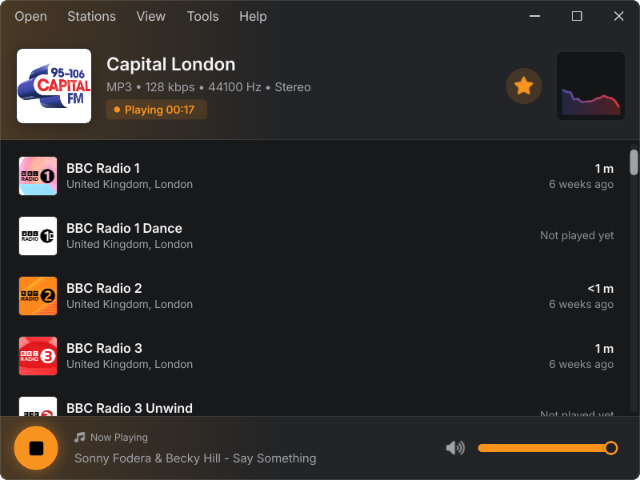
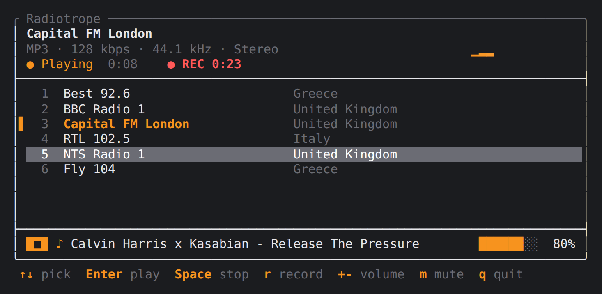

# Radiotrope

[](https://github.com/goten002/radiotrope/actions/workflows/ci.yml)
[](LICENSE)

An internet radio player for the desktop, written in Rust with [Slint](https://slint.dev).
Play it yourself, from your phone, or let your AI assistant drive it over the
[Model Context Protocol (MCP)](https://modelcontextprotocol.io).



- **Find stations**: typo-tolerant search by name, country, genre and language in the Radiotrope station directory, or play any stream address
- **Plays almost anything**: MP3, AAC, HE-AAC, Vorbis, Opus and FLAC over Icecast/SHOUTcast, HLS and plain HTTP, with song titles from ICY and ID3
- **Sounds right**: 10-band equalizer with 14 presets, volume leveler, hiss, hum and rumble filters
- **Records**: MP3, Opus or WAV, by hand or on a schedule
- **Wakes you, sends you to sleep**: Scheduler for plays, recordings and stops, plus a sleep timer
- **AI agents**: 19 MCP tools, shared by every agent on your computer or your network
- **Phone remote**: pair the Radiotrope Remote app with a QR code
- **Also**: a terminal player, a station checker for monitoring, and an experimental Raspberry Pi kiosk image

## Contents

- [Install](#install)
- [Using the desktop app](#using-the-desktop-app)
- [AI agents (MCP)](#ai-agents-mcp)
- [Phone remote](#phone-remote)
- [Terminal player](#terminal-player)
- [Station checker](#station-checker)
- [Raspberry Pi appliance (experimental)](#raspberry-pi-appliance-experimental)
- [Supported streams and formats](#supported-streams-and-formats)
- [Project layout](#project-layout)
- [Development](#development)
- [License](#license)

## Install

There are no prebuilt packages yet; build from source with Rust 1.92 or newer
([rustup](https://rustup.rs)).

### Linux

Install the build dependencies (ALSA for audio, fontconfig for the GUI, CMake
and a C++ compiler for the bundled libopus and fdk-aac):

```bash
# Debian / Ubuntu
sudo apt install libasound2-dev libfontconfig1-dev cmake g++ pkg-config
# Arch / Manjaro
sudo pacman -S alsa-lib fontconfig cmake gcc pkgconf
# Fedora
sudo dnf install alsa-lib-devel fontconfig-devel cmake gcc-c++ pkgconf-pkg-config
```

Then build:

```bash
git clone https://github.com/goten002/radiotrope.git
cd radiotrope
cargo build --release
```

This gives three programs in `target/release/`:

| Program | What it is |
|---------|------------|
| `radiotrope` | The desktop app, and the MCP server for agents |
| `radiotrope-cli` | The terminal player |
| `radiotrope-probe` | The station checker |

To have the dock or taskbar show the app's icon, install the desktop file
under the name `radiotrope.desktop` (it matches the window's app id) and the
icons:

```bash
sudo install -Dm644 packaging/linux/radiotrope.desktop /usr/share/applications/radiotrope.desktop
for s in 16 32 48 64 128 256; do
  sudo install -Dm644 assets/icons/icon-$s.png /usr/share/icons/hicolor/${s}x${s}/apps/radiotrope.png
done
```

### Windows

1. Install Rust with [rustup](https://rustup.rs) (the default MSVC toolchain).
2. Install the Visual Studio 2022 Build Tools with the **Desktop development with C++** workload.
3. Install [CMake](https://cmake.org/download/) and make sure it is on `PATH`.
4. Optional: install Git, so **Help > About** shows the commit the build came from.

```powershell
git clone https://github.com/goten002/radiotrope.git
cd radiotrope
cargo build --release
```

The programs are in `target\release\` with an `.exe` ending. The release app
opens without a console window. Started from a terminal it prints its log
there; otherwise the log goes to `%LOCALAPPDATA%\radiotrope\radiotrope.log`.

## Using the desktop app

Run `radiotrope`. A second start brings the open window forward instead of
opening another player.

| To... | Go to |
|-------|-------|
| Search the station directory | **Stations > Search Stations** or **By Country** |
| Play a stream by its address (stream, PLS, M3U or HLS) | **Open > Network Stream** |
| Save, reorder and edit favorites | the star on the playing station; drag rows by their logo; right-click a row |
| Move favorites between computers or phones | **Stations > Export / Import Favorites** (an import shows a preview first) |
| Shape the sound | **Tools > Equalizer** and **Tools > Filters** (volume leveler, hiss reducer, hum and rumble filters, smooth switching) |
| Record the station playing | **Tools > Start Recording**; **Tools > Recordings > Settings** for format, bitrate and folder |
| Start, record or stop at set times | **Tools > Scheduler** (once or weekly, with fade-in and an alarm fallback) |
| Stop after a while | **Tools > Sleep Timer** |
| See stream and decoder details | **Tools > Statistics**, or **View > Show Station Stats** on the favorites |
| Change the look | **View**: Dark, Light or System theme, accent color, visualizer (spectrum, mirror, bars, VU, wave, dot matrix) |
| Keep it in the system tray | **View > System Tray** (show icon, close or minimize to tray, start hidden) |

Scheduled entries and the sleep timer only work while the app is running; they
do not wake the computer. Recordings go to `Music/Radiotrope` unless you pick
another folder.

On GNOME, the tray icon needs the AppIndicator extension.

### Where things are saved

Favorites, listening stats, settings, schedules and pairings are JSON files in
the config folder: `~/.config/radiotrope/` on Linux and
`%APPDATA%\radiotrope\` on Windows. They are written atomically with a backup,
and two open players see each other's favorite changes.

Logging goes through the standard `log` crate: set `RUST_LOG`, for example
`RUST_LOG=radiotrope=debug`, to see more.

## AI agents (MCP)

Every agent talks to the one player running on your computer, so you hear the
same music whichever agent asks. Closing an agent leaves the music playing.

### Set it up

The quickest way is **Tools > Connections > Agents (MCP)**: pick your agent (Claude Code,
Claude Desktop, Codex CLI, Gemini CLI, VS Code or Cursor) and copy the line or
JSON it shows. By hand, the configuration is:

```json
{
  "mcpServers": {
    "radiotrope": {
      "command": "radiotrope",
      "args": ["--mcp"]
    }
  }
}
```

| Command | What it does |
|---------|--------------|
| `radiotrope --mcp` | Connects the agent to the running player, starting it first if needed |
| `radiotrope --mcp --standalone` | Gives the agent a separate player of its own |

Then ask things like *"play BBC Radio 1"*, *"find jazz stations from France"*,
*"record this for an hour"* or *"wake me at 7 with my first favorite"*. A robot
chip in the menu bar shows how many agents are using the player; hover it for
details.

### Tools

| Area | Tools |
|------|-------|
| Playback | `play_url`, `play_station`, `play_favorite`, `stop`, `set_volume`, `set_muted`, `get_status` |
| Stations | `search_stations`, `list_categories` |
| Favorites | `list_favorites`, `add_favorite`, `remove_favorite` |
| Recording | `start_recording`, `stop_recording` |
| Timer and Scheduler | `set_sleep_timer`, `list_schedule`, `add_schedule_entry`, `remove_schedule_entry`, `set_schedule_entry_enabled` |

The server is built on [rmcp](https://github.com/modelcontextprotocol/rust-sdk),
the official Rust SDK, and speaks every MCP version from 2024-11-05 to
2026-07-28. Data comes back as structured JSON with output schemas, and every
tool carries hints (read-only, destructive, open-world) that clients use when
asking for confirmation.

### Agents on other computers

Network access (MCP Streamable HTTP) is off until you turn it on in
**Tools > Connections > Agents (MCP)**. There you choose:

- **Listen on**: this computer only (`127.0.0.1`, the default), one network
  interface, or all networks. Port 8765 by default. A chosen interface keeps
  working when its address changes.
- **Authentication**: None, or a **Token** that every request must send as
  `Authorization: Bearer <token>`. The dialog shows a ready line for the agent
  you picked, for example:

  ```bash
  claude mcp add --transport http radiotrope http://192.168.1.20:8765/mcp \
    --header "Authorization: Bearer <token>"
  ```

> [!IMPORTANT]
> The server speaks plain HTTP, meant for your own network. With
> Authentication set to None, anyone who can reach the address controls the
> player, and even a token travels unencrypted. Requests from web pages (with an `Origin` header) are always refused.

The claude.ai and Claude Desktop "custom connectors" connect from Anthropic's
cloud, so they cannot reach a player on your home network. Use Claude Code, or
`radiotrope --mcp` on the same computer.

## Phone remote

Turn on **Tools > Connections > Remote Control**, press **Pair a Phone**, and
scan the QR code with the Radiotrope Remote app, or type the code it shows.
The player announces itself on the local network, so the phone finds it.

A paired phone can search and play stations, manage favorites, listen to the
station on the phone itself, change the equalizer, filters, sleep timer and
Scheduler, start recordings, and list, download or delete them.

## Terminal player

```bash
radiotrope-cli            # your favorites from the app
radiotrope-cli 3          # play favorite number 3
radiotrope-cli capital    # play the first favorite whose name contains "capital"
radiotrope-cli <URL>      # play a stream address
```

| Key | Action |
|-----|--------|
| `↑` `↓` (or `k` `j`) | Pick a favorite |
| `Enter` | Play it |
| `Space` | Stop, or play again |
| `n` `p` | Next and previous favorite |
| `+` `-` | Volume |
| `m` | Mute |
| `r` | Start or stop recording (with the app's recording settings) |
| `q` | Quit |

It reads the app's favorites and settings and never changes them.



## Station checker

`radiotrope-probe` connects to a station the way the player does, listens for
a few seconds (no sound card needed) and reports whether it is on air, its
format, its sound level and what is playing.

```bash
radiotrope-probe http://example.com/radio.pls       # readable report
radiotrope-probe --json <URL>...                    # JSON for scripts
radiotrope-probe --ndjson --input stations.txt      # one JSON line per station
radiotrope-probe --quiet --listen 5 <URL>...        # one line per station
```

Run `radiotrope-probe --help` for the timeout, parallel jobs and silence level.

| Exit status | Meaning |
|-------------|---------|
| 0 | Up |
| 1 | Degraded: silent, slower than real time, stalling, many decode errors, or ended |
| 2 | Down, with an error code such as `dns`, `connect`, `http_status`, `web_page` or `timeout` |
| 3 | The check could not run |

With several stations the worst one counts, which suits cron, systemd timers,
Task Scheduler and Nagios-style monitors. On Linux it needs the ALSA runtime
library (`libasound2`) even though it plays nothing.

## Raspberry Pi appliance (experimental)

> [!NOTE]
> The Raspberry Pi image is experimental: it is built and tested on one
> hardware setup only, and things may change or break between versions.

The `yocto/` folder builds a minimal Linux image that runs Radiotrope as a
touch-screen kiosk on a Raspberry Pi 3B+ with a 5" DSI display and an I2S
amplifier, including WiFi settings and an on-screen keyboard. See
[yocto/README.md](yocto/README.md) for the hardware and build steps.

## Supported streams and formats

| | Supported |
|-|-----------|
| **Protocols** | Icecast/SHOUTcast (ICY), HLS (MPEG-TS, packed audio), plain HTTP/HTTPS, PLS and M3U playlists |
| **Codecs** | MP3, AAC-LC, HE-AAC (shown as AAC+), Vorbis, Opus, FLAC, WAV/PCM |
| **Song titles** | ICY metadata; ID3v1/ID3v2 tags in MP3, AAC and HLS streams when ICY gives none; legacy text encodings |

Streams reconnect with backoff after network drops, and a stalled or silent
stream is detected and reported.

## Project layout

A Cargo workspace with four crates:

| Crate | Kind | Description |
|-------|------|-------------|
| [`radiotrope`](crates/radiotrope) | Library | The streaming engine: resolving, decoding, buffering, DSP, recording, health monitoring. Usable in any Rust program |
| [`radiotrope-app`](crates/radiotrope-app) | Binary | The desktop app, MCP server and phone remote server |
| [`radiotrope-cli`](crates/radiotrope-cli) | Binary | The terminal player, built with [ratatui](https://github.com/ratatui/ratatui) |
| [`radiotrope-probe`](crates/radiotrope-probe) | Binary and library | The station checker |

## Development

```bash
cargo test --workspace
cargo clippy --workspace --all-targets -- -D warnings
cargo fmt --check
```

CI runs these on Linux and Windows for every pull request to `main`, and also
checks the Raspberry Pi build
(`cargo check -p radiotrope-app --no-default-features --features embedded`).
Changes are listed in [CHANGELOG.md](CHANGELOG.md).

## License

Copyright (C) 2026 George Alexiou

Radiotrope is free software: you can redistribute it and/or modify it under
the terms of the GNU General Public License as published by the Free Software
Foundation, either version 3 of the License, or (at your option) any later
version. See [LICENSE](LICENSE) for the full text.

Radiotrope is distributed in the hope that it will be useful, but WITHOUT ANY
WARRANTY; without even the implied warranty of MERCHANTABILITY or FITNESS FOR A
PARTICULAR PURPOSE. See the GNU General Public License for more details.

**Additional permission under GNU GPL version 3 section 7:** if you modify
Radiotrope, or any covered work, by linking or combining it with the
Fraunhofer FDK AAC library (libfdk-aac), or a modified version of that library,
containing parts covered by the terms of the Fraunhofer FDK AAC Codec Library
license, the licensors of Radiotrope grant you additional permission to convey
the resulting work.

This project includes third-party dependencies with different licenses.
See [THIRD-PARTY-LICENSES](THIRD-PARTY-LICENSES) for details.
